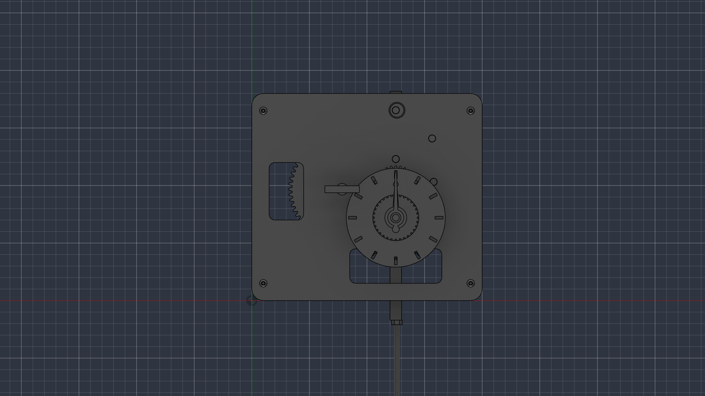
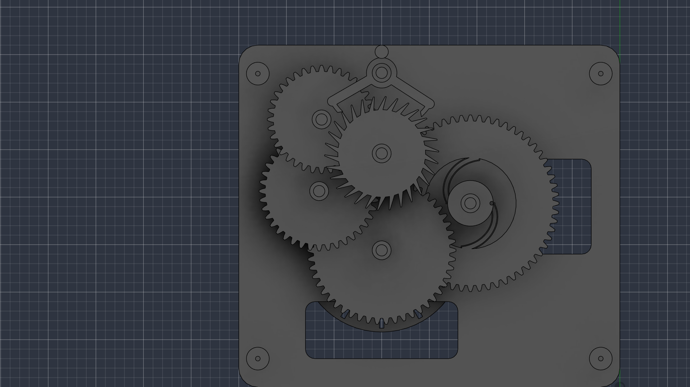

# Mechanical Wall Clock

A weight driven mechanical wall clock that is mostly 3D printable. A slowly dropping weight powers the gear train, deadbeat escapement and about a 1 meter long pendulum lets it tick once every second. Predicted to run about 4 days per wind but untested practically. Printable except some rods, nuts and similar parts.

## Features

- Driven by weights, should run about 4 days on each wind
- Roughly 1 meter long pendulum which ticks each second
- Deadbeat escapement
- 60:1 gear train for the minute hand, 12:1 motion works for hour hand
- Winding from the front via a knob
- Adjustable escapement depth (bushings) and adjustable tick rate
- Partially open dial to show mechanism
- Keyhole feet for wall hanging
- Fits on a 250x210 milimeter printing bed

## Motivation

At home, we have an old grandfather clock. I've always wondered how mechanical clocks really work, so I looked for some printable clocks online and found concepts on Thingiverse and MakerWorld and decided to try to make my own. I was also able to properly learn Fusion after I've only had limited experience working in Autodesk Inventor.

## Functionality

The weight hangs on a cord wrapped around the winding drum. As it drops at a slow pace, the drum is turned, driving the Great Wheel through a ratchet. The Great Wheel drives the center arbor, which turns once every hour and moves the minute hand. From the center arbor, there is a 60:1 gear train (50/10 x 40/10 * 36/12) which runs up to the escape wheel, turning it once per minute. The anchor allows the escape wheel to advance one tooth on each swing of the pendulum, which is exactly one revolution per minute. On the front plate, there are the motion works which create a 12:1 gear ratio slowing the hour hand to turn once every 12h. Turning the winding knob turns the drum and lifts the weight. 

## How it was made

This was my first project in Fusion, so I learned a lot along the way. Thankfully, Fusion has a very useful SpurGear script for generating gears and I built the rest from sketches. I ran into several issues though.
- My first gear ratio was wrong, I thought I'd need 120:1 but I only needed 60:1.
- Interference checks in Fusion kept complaining about gear teeth clipping into each other, but they just needed a slight turn
- The minute hand would originally run backwards and I had to mirror the escapement
- To save material and make it more easily printable, I had to shrink the plates from the original 250 milimeters to 200
- I struggled with the extrude tool, as I'd often switch directions (negative/pos sign) or join into wrong components
- Several printability issues showed up near the end, such as the Great Wheel being unprintable due to gaps too small, the minute wheel possibly sliding off its stud, etc.

## Tech stack

- Fusion 360 for the CAD 
- SpurGear script
- PrusaSlicer / Bambu Studio for printing

## Repo layout

- cad/ has the entire clock as a step file
- stl/ has one STL for each printed part
- images/ has screenshots of the model
- BOM.csv has the parts list (also available below)
- JOURNAL.md is the devlog

## Bill of materials

| Part | Qty | Source | Unit | Total |
|---|---|---|---|---|
| [Alu round rod 6mm, 1m](https://www.hornbach.cz/p/alu-kruhovy-profil-6mm-1m/6369446/) | 1 | Hornbach | $2.50 | $2.50 |
| [Zn threaded rod M5, 1m](https://www.hornbach.cz/p/tyc-zavitova-1m-m5-pevnost-4-8-zinek-bily-1ks/4279646/) | 1 | Hornbach | $0.80 | $0.80 |
| [DIN 7985 cross-head M4x12 pan-head screws, 100 pack](https://www.hornbach.cz/p/sroub-s-cockovitou-hlavou-4-8-a-krizovou-drazkou-din-7985-m4x12-mm-galvanicky-pozinkovany-1-ks/3831265/) | 1 | Hornbach | $3.93 | $3.93 |
| [M5 hex nuts, stainless A2, 20 pack](https://www.hornbach.cz/p/matice-presna-m5-sestihranna-nerez-a2-20ks/8718281/) | 1 | Hornbach | $1.56 | $1.56 |
| [Bison Super Glue Gel 2g](https://www.hornbach.cz/p/vterinove-lepidlo-bison-super-glue-gel-2-g/6065686/) | 1 | Hornbach | $2.08 | $2.08 |
| [Polyester line 1mm, 50m](https://www.hornbach.cz/p/zednicky-provazek-haromac-delka-50m-cerveny/910338/) | 1 | Hornbach | $3.40 | $3.40 |
| [Elegoo PLA grey, 1.75mm, 1kg](https://www.sunnysoft.cz/z/400PEO-060/elegoo-pla-1-75-1kg-seda.html) | 1 | Sunnysoft | $12.00 | $12.00 |
| **Parts subtotal** | | | | **$26.27** |
| Shipping (estimate) | | | | $3.00 |
| **Total** | | | | **$29.27** |

Also required but not in the BOM as will be sourced separately (for free, or possibly already held by me):
- 8x M3x10 DIN 965 screws for the plates
- A bit of dry sand to fill the bob
- A slim drive weight of 1-3kg. At most 4-5 cm wide, otherwise the bob could hit it when the weight drops too low. Consider a narrow tube filled with sand.
- 2 wall screws with plugs (heads must be under 9 mm wide and shanks under 4.5 mm to fit)
- Tools: a hacksaw, sandpaper or a file, and a cross-head screwdriver

## Printing

- PLA, 0.4mm nozzle, 0.2mm layers, 3 walls, 20% infill
- 4 walls for the pendulum top, the bushings, winding drum, as they're either threaded or clamped
- Only use tree supports for the arbors. Everything else should be printable without supports.
- Print the plates inner face down with the feet and studs facing up, arbors standing up, Great Wheel front face down, bob with pockets facing up, dial face down
- Print standoffs quadrice
- In total, it should all fit on a 250x210mm bed. Account for 10+ hours of printing, possibly a lot more depending on your printer

## Assembly

1) Print the tolerance test and adjust the holes if needed. Try pushing your aluminium rod through the holes (6mm to 6.8mm). The smallest one where it freely spins is your bearing size. Also verify the M5 rod and M4 screw bite into the last two holes. Then print all the components.
2) Cut the 6 axles from the 1 meter long aluminium rod with your hacksaw and sand the ends smooth. Be precise: Center Axle 78 milimeters, Great axle 70 milimeters, Anchor axle 62 milimeters, Third axle 56 milimeters, Fourth axle 56 milimeters, Escape axle 56 milimeters
3) Glue each arbor onto its axle at the correct position from the CAD model. Glue the winding drum onto the great axle but take care not to glue the great wheel as it needs to spin freely on the axle. It is only driven via the ratchet.
4) Push one end of the cord through the small hole in the drum's rear flange and knot it behind it. Make sure to do this before closing the plates.
5) Push the back bushing into the back plate from the outside, then place the back plate down on its feet. Screw in the 4 standoffs using your M3 screws.
6) Place all the arbors in their bearing holes. Lower the front plate onto all the axles at once. Screw it down and push the front bushing in from the front.
7) Spin the train by hand and verify all turns freely.
8) Setup the motion works, the cannon pinion on the center axle (if it slips, consider adding a drop of glue), the minute wheel on its stud, hour wheel over the cannon pinion. Glue the dial's pillars into the front plate, push on the hands and glue collet on tip of center axle. Glue the winding knob onto the great axle.
9) Fill the bob with dry sand and glue the lid on
10) Screw the M5 rod into the pendulum top's block slowly, tighten a nut up against it to lock it in place. Slide the bob in from the bottom, thread the rating and lock nut under it. Start by mirroring the bob's center position like in CAD, and adjust later (see below)
11) Put the crutch on the anchor axle behind the back plate. Hang the pendulum on suspension bracket with M4 screw and crutch pin sitting in pendulum's slot.
12) Put 2 screws in the wall, exactly 150 milimeters apart with the heads sticking out about 4 milimeters. Push the heads into the round part of the top keyholes, slide the clock down
13) Hang the weight on the cord carefully and wind the clock up.

## Tuning
Keep in mind your clock likely won't run perfectly immediately. Consider these adjustments:
- If the clock jams, the anchor might have a grip that is too deep. If the escape wheel is spinning freely, it is likely too shallow. Turn both bushings by the same amount until it ticks reliably and lock them with a bit of glue.
- The tick and the tock of the clock should be evenly spaced. If not, twist the crutch slightly on the anchor axle until it is.
- Start around 1 kg of weight and add until it keeps running with a swing of few degrees. Don't go heavier than needed to reduce stress
- If the clock is too fast, lower the bob by turning the rating nut down. If it is slow, go vice versa.

## AI disclosure
LLMs (Claude Opus 5.5) was used to get feedback on the concepts, verify and help with the math and underlying physics, review my sketches and general work and assist in finding and fixing bugs in my design and realization. Also used for other tedious but simple task, like adding the BOM to this README.

---

Built for [Hack Club Half Life](https://halflife.hackclub.com/) Week 2 (CAD).